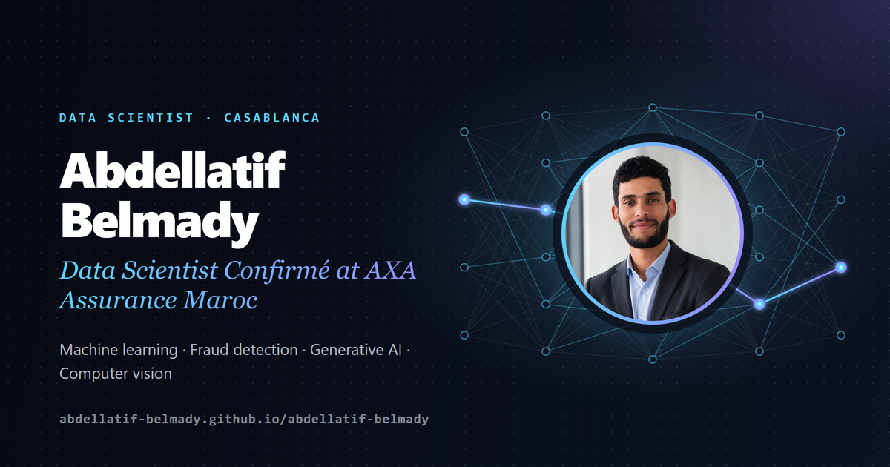

<h2 align="center">Hi, I'm Abdellatif Belmady 👋</h2>

  <strong>Data Scientist Confirmé at AXA Assurance Maroc</strong> · Casablanca, Morocco 
  Machine learning for auto insurance fraud detection · Generative AI · Computer vision

  
  
  
  

## About me

I'm a data scientist and a graduate of **École Centrale Casablanca** (M.Sc. in Data Science & Digitalization). Since June 2026 I have been working at **AXA Assurance Maroc** on a machine-learning project to detect fraud in auto insurance.

Before that, I spent two and a half years building AI products end to end:

- **Wineo Artificial Intelligence** (ML Engineer, 2025 – 2026): a semantic search engine over historical production data that cut by 70% the time needed to find similar projects, and manufacturing-time prediction models (one per work centre, MAPE < 15%).
- **The Game Changer Company** (Data Scientist | AI Engineer, 2024 – 2025): a multi-stage LangGraph agent that turns a project brief into a full plan and Gantt chart, RAG chatbots, a generative quiz platform, and computer-vision applications running on the edge (NVIDIA Jetson Nano).
- **Internships** in France and Morocco (2021 – 2023): deep learning on health data at Solefarma, object detection in operating rooms at 6 PERFORM, industrial analytics at VCR Sodalmou.

## What I work on

| | |
|---|---|
| 🛡️ **Fraud detection & ML** | Supervised learning, feature engineering, model evaluation, ensemble stacking |
| ✨ **Generative AI** | LangGraph agents, RAG with LangChain and ChromaDB, semantic search, local LLMs with Ollama |
| 👁️ **Computer vision** | YOLO object detection, face and facial-attribute analysis, fine-tuned CNNs, edge AI |
| ⚙️ **ML engineering** | FastAPI and Flask services, Docker, REST APIs, Dash & Plotly dashboards, cloud and on-premise deployment |

## Toolbox

  
  
  
  
  
  
  
  
  
  
  
  
  
  
  
  

## Latest on my blog

- [AI near-misses as incidents: what the UK regulator's latest message means for fraud models](https://abdellatif-belmady.github.io/abdellatif-belmady/blog/fca-ai-failures-near-misses/)
- [Meta opens the weights of an 816B agentic model: what it changes for regulated data teams](https://abdellatif-belmady.github.io/abdellatif-belmady/blog/meta-muse-spark-open/)

Opinions are my own and do not represent my employer.

## GitHub stats

  
  

---

This repository also hosts the source of my portfolio, built with <a href="https://zensical.org/">Zensical</a> and published to GitHub Pages. Maintenance notes: <a href="tools/README.md">tools/README.md</a>.
